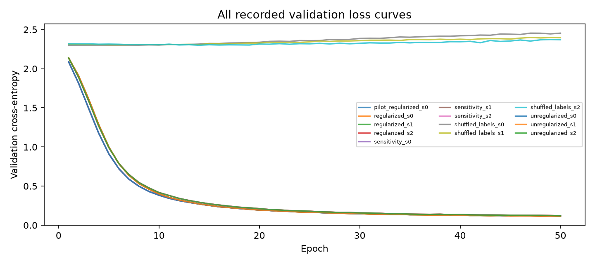

# Abstract

This report records a bounded research cycle executed through Claude Code. The mean paired accuracy difference is 0.000000, with conditional 95% bootstrap interval [0.000000, 0.000000]. The registered decision is **inconclusive**. The sample standard deviation across seed effects is 0.000000. The interval uses 10000 paired resamples of test examples and conditions on the trained models.

Recorded harness status: **complete**; 8 operational phases accepted. Measurements below do not imply completion of unaccepted phases.

# Context, motivation, and introduction

Does AdamW weight decay improve held-out accuracy of a small MLP on the bundled digits data?

The objective is reproducible evidence and an inspectable research process. This study does not establish broad scientific reliability or superiority of an agent model.

# Background and method

- **analysis_kind**: "exploratory"
- **prior_results_known**: true
- **objective**: "Replicate a known fixed study to evaluate engineering completion; do not claim new scientific confirmation."
- **question**: "Does AdamW weight decay improve held-out accuracy of a small MLP on the bundled digits data?"
- **architecture**: [64, 128, 10]
- **optimizer**: "AdamW"
- **learning_rate**: 0.001
- **batch_size**: 64
- **epochs**: 50
- **methods**: ["regularized", "unregularized", "sensitivity", "shuffled_labels", "logistic", "class_prior"]
- **seeds**: [0, 1, 2]
- **data_boundaries**: "Frozen stratified 60/20/20 train/validation/test partition. Split seed 42. Divide pixels by the documented constant 16. Pilot reports validation only. No learned preprocessing or selection uses test data. Generalization is limited to this random example split, not new writers or datasets. Prior results on this evaluation set are known. All replication observations and conclusions are exploratory; no untouched-data claim is made."
- **analysis_plan**: "Use 10000 paired bootstrap resamples of test example indices with RNG seed 2026, preserving pairing across methods and all trained seeds. This interval conditions on the trained models and does not estimate training-population uncertainty. Separately show each seed effect and its sample standard deviation. Treat other comparisons as descriptive, with no post-hoc primary selection."
- **hyperparameter_rationale**: "Small prespecified network and fixed training budget provide fast feedback on an established task. The three decay values are a descriptive local sensitivity check, not a test-selected sweep. Three seeds expose limited initialization sensitivity; they do not support broad population claims."

*Research architecture.*

*Registered model architecture.*

# Results

| Method | Seed | Split | Accuracy | Seconds | Device |
|-------------------------|-----:|------------|-----------:|----------:|----------|
| class prior | 0 | test | 0.102778 | 0.030 | cpu |
| logistic | 0 | test | 0.955556 | 0.124 | cpu |
| regularized | 0 | validation | 0.966574 | 8.906 | cuda |
| regularized | 0 | test | 0.963889 | 0.266 | cuda |
| regularized | 1 | test | 0.969444 | 6.516 | cuda |
| regularized | 2 | test | 0.969444 | 2.524 | cuda |
| sensitivity | 0 | test | 0.963889 | 2.625 | cuda |
| sensitivity | 1 | test | 0.969444 | 2.594 | cuda |
| sensitivity | 2 | test | 0.969444 | 2.621 | cuda |
| shuffled labels | 0 | test | 0.061111 | 2.660 | cuda |
| shuffled labels | 1 | test | 0.116667 | 2.385 | cuda |
| shuffled labels | 2 | test | 0.108333 | 2.384 | cuda |
| unregularized | 0 | test | 0.963889 | 2.455 | cuda |
| unregularized | 1 | test | 0.969444 | 2.447 | cuda |
| unregularized | 2 | test | 0.969444 | 2.443 | cuda |

The mean paired accuracy difference is 0.000000, with conditional 95% bootstrap interval [0.000000, 0.000000]. The registered decision is **inconclusive**. The sample standard deviation across seed effects is 0.000000. The interval uses 10000 paired resamples of test examples and conditions on the trained models.

*All recorded accuracies.*

*Recorded learning curves.*

*First saved test examples; no correctness-based selection.*

# Claims and evidence

- **claim-primary-null**: On this digits fixture, AdamW weight decay 0.01 vs 0 produced no measurable change in test accuracy: the paired-bootstrap interval for the primary effect is degenerate at zero and predictions are identical in all three seeds. h1 (positive effect) is not supported; it is not falsified, and equivalence is not established. Evidence: [regularized_s0](https://github.com/BurnyCoder/eureka-digits-sonnet/blob/main/cycles/001/results/regularized_s0.json), [regularized_s1](https://github.com/BurnyCoder/eureka-digits-sonnet/blob/main/cycles/001/results/regularized_s1.json), [regularized_s2](https://github.com/BurnyCoder/eureka-digits-sonnet/blob/main/cycles/001/results/regularized_s2.json), [unregularized_s0](https://github.com/BurnyCoder/eureka-digits-sonnet/blob/main/cycles/001/results/unregularized_s0.json), [unregularized_s1](https://github.com/BurnyCoder/eureka-digits-sonnet/blob/main/cycles/001/results/unregularized_s1.json), [unregularized_s2](https://github.com/BurnyCoder/eureka-digits-sonnet/blob/main/cycles/001/results/unregularized_s2.json), [audit-experiments](https://github.com/BurnyCoder/eureka-digits-sonnet/blob/main/cycles/001/research/evidence-snapshots/3f1888c9c08d04cb46792effbedc9b8c0bd2a86d888d193131bb2e52d532cfac.json). Limitations: The bootstrap conditions on the trained models and does not estimate training-population variance. The finite test set limits inference about unseen examples. Prior Haiku/Luna results are known, so this is not confirmation or an equivalence test.
- **claim-decay-applied**: Parameters and training losses differ between decay arms while predictions agree. This is consistent with different training trajectories; the comparison alone does not prove correct implementation of the decay update or rule out every bug. Evidence: [regularized_s0](https://github.com/BurnyCoder/eureka-digits-sonnet/blob/main/cycles/001/results/regularized_s0.json), [regularized_s1](https://github.com/BurnyCoder/eureka-digits-sonnet/blob/main/cycles/001/results/regularized_s1.json), [regularized_s2](https://github.com/BurnyCoder/eureka-digits-sonnet/blob/main/cycles/001/results/regularized_s2.json), [unregularized_s0](https://github.com/BurnyCoder/eureka-digits-sonnet/blob/main/cycles/001/results/unregularized_s0.json), [unregularized_s1](https://github.com/BurnyCoder/eureka-digits-sonnet/blob/main/cycles/001/results/unregularized_s1.json), [unregularized_s2](https://github.com/BurnyCoder/eureka-digits-sonnet/blob/main/cycles/001/results/unregularized_s2.json), [audit-experiments](https://github.com/BurnyCoder/eureka-digits-sonnet/blob/main/cycles/001/research/evidence-snapshots/3f1888c9c08d04cb46792effbedc9b8c0bd2a86d888d193131bb2e52d532cfac.json), [src-adamw-doc](https://docs.pytorch.org/docs/2.15/generated/torch.optim.AdamW.html). Limitations: Post-hoc audit. Weight differences cannot separate the decay effect from run-to-run divergence; no much-larger-decay ablation was run.
- **claim-small-decay-explanation**: A possible explanation for unchanged accuracy is the small per-step decay coefficient at the registered learning rate and weight decay. This is an untested hypothesis: gradient trajectories and decision margins also matter, so the coefficient alone does not establish the size of the fitted model change. Evidence: [src-adamw-doc](https://docs.pytorch.org/docs/2.15/generated/torch.optim.AdamW.html), [src-adamw-paper](https://arxiv.org/abs/1711.05101), [regularized_s0](https://github.com/BurnyCoder/eureka-digits-sonnet/blob/main/cycles/001/results/regularized_s0.json), [regularized_s1](https://github.com/BurnyCoder/eureka-digits-sonnet/blob/main/cycles/001/results/regularized_s1.json), [regularized_s2](https://github.com/BurnyCoder/eureka-digits-sonnet/blob/main/cycles/001/results/regularized_s2.json), [unregularized_s0](https://github.com/BurnyCoder/eureka-digits-sonnet/blob/main/cycles/001/results/unregularized_s0.json), [unregularized_s1](https://github.com/BurnyCoder/eureka-digits-sonnet/blob/main/cycles/001/results/unregularized_s1.json), [unregularized_s2](https://github.com/BurnyCoder/eureka-digits-sonnet/blob/main/cycles/001/results/unregularized_s2.json). Limitations: Hypothesis from arithmetic on the documented update rule, not an intervention; the sensitivity arm (weaker decay) does not test larger decay.
- **claim-sensitivity**: The weaker-decay sensitivity arm also matched the unregularized arm in observed accuracy. This statement concerns accuracy at the tested settings, not all model outputs or a population dose-response. Evidence: [sensitivity_s0](https://github.com/BurnyCoder/eureka-digits-sonnet/blob/main/cycles/001/results/sensitivity_s0.json), [sensitivity_s1](https://github.com/BurnyCoder/eureka-digits-sonnet/blob/main/cycles/001/results/sensitivity_s1.json), [sensitivity_s2](https://github.com/BurnyCoder/eureka-digits-sonnet/blob/main/cycles/001/results/sensitivity_s2.json), [unregularized_s0](https://github.com/BurnyCoder/eureka-digits-sonnet/blob/main/cycles/001/results/unregularized_s0.json), [unregularized_s1](https://github.com/BurnyCoder/eureka-digits-sonnet/blob/main/cycles/001/results/unregularized_s1.json), [unregularized_s2](https://github.com/BurnyCoder/eureka-digits-sonnet/blob/main/cycles/001/results/unregularized_s2.json), [audit-experiments](https://github.com/BurnyCoder/eureka-digits-sonnet/blob/main/cycles/001/research/evidence-snapshots/3f1888c9c08d04cb46792effbedc9b8c0bd2a86d888d193131bb2e52d532cfac.json). Limitations: Only one weaker dose; descriptive role only.
- **claim-controls**: Controls behaved as expected: shuffled-label training scored near chance, the class-prior baseline near chance, and logistic regression slightly below the MLPs, so the pipeline measures real signal. Evidence: [shuffled_labels_s0](https://github.com/BurnyCoder/eureka-digits-sonnet/blob/main/cycles/001/results/shuffled_labels_s0.json), [shuffled_labels_s1](https://github.com/BurnyCoder/eureka-digits-sonnet/blob/main/cycles/001/results/shuffled_labels_s1.json), [shuffled_labels_s2](https://github.com/BurnyCoder/eureka-digits-sonnet/blob/main/cycles/001/results/shuffled_labels_s2.json), [class_prior_s0](https://github.com/BurnyCoder/eureka-digits-sonnet/blob/main/cycles/001/results/class_prior_s0.json), [logistic_s0](https://github.com/BurnyCoder/eureka-digits-sonnet/blob/main/cycles/001/results/logistic_s0.json), [regularized_s0](https://github.com/BurnyCoder/eureka-digits-sonnet/blob/main/cycles/001/results/regularized_s0.json), [regularized_s1](https://github.com/BurnyCoder/eureka-digits-sonnet/blob/main/cycles/001/results/regularized_s1.json), [regularized_s2](https://github.com/BurnyCoder/eureka-digits-sonnet/blob/main/cycles/001/results/regularized_s2.json), [audit-experiments](https://github.com/BurnyCoder/eureka-digits-sonnet/blob/main/cycles/001/research/evidence-snapshots/3f1888c9c08d04cb46792effbedc9b8c0bd2a86d888d193131bb2e52d532cfac.json). Limitations: Logistic baseline has one seed and untuned hyperparameters; its gap to the MLP is small and uncertainty was not quantified.
- **claim-prior-context**: This run was executed with prior Haiku/Luna results known, so it provides exploratory replication only, not independent confirmation. Evidence: [src-prior-haiku](https://github.com/BurnyCoder/eureka-digits-haiku), [src-prior-luna](https://github.com/BurnyCoder/eureka-digits-luna). Limitations: Prior runs were summarized from their READMEs, not re-derived.

# Discussion, implications, and learnings

# Interpretation (exploratory)

This text includes disclosed [parent corrections](https://github.com/BurnyCoder/eureka-digits-sonnet/blob/main/reports/parent-review.md) after the recorded model run. The measurements and controller counters are unchanged.

## Motivation
Does AdamW weight decay (0.01 vs 0) improve held-out accuracy of a small MLP on the bundled digits data? Prior Haiku and Luna runs on this evaluation set are known (`src-prior-haiku`, `src-prior-luna`), so this run is an **exploratory engineering replication**, not confirmation.

## Context
AdamW decouples decay from the gradient update (`src-adamw-paper`; update rule in `src-adamw-doc`). Data: scikit-learn digits, 1797 x 64, 10 classes (`src-load-digits`, `src-uci-digits`). Checkpoints use safetensors (`src-safetensors-doc`). Process guidance: `src-nanda-sequence`, `src-lones-pitfalls`.

## Methods
Fixed fixture `study.py` (unchanged; hashes recorded in each result). Arms with seeds 0-2: `regularized_s*` (wd 0.01), `unregularized_s*` (wd 0), `sensitivity_s*` (wd 0.001), `shuffled_labels_s*` (control); single-seed baselines `logistic_s0`, `class_prior_s0`; pilot `pilot_regularized_s0` (validation only). Primary metric: mean paired test-accuracy difference, regularized minus unregularized, with 10000 paired bootstrap resamples (`research/protocol.json`). Predictions were recorded before the run (`research/experiment-predictions.md`). Post-hoc audit `audit-experiments`: metric recomputation, weight and loss comparison. All numbers live in `results/*.json`, `research/experiment-analysis.json` and the controller-generated `reports/metrics.json`; none are retyped here.

## Findings
- **Primary (claim-primary-null):** the paired-bootstrap interval is degenerate at zero and predictions are identical in every seed. h1 is not supported and not falsified; under the preregistered rule an interval spanning zero is inconclusive, and equivalence cannot be claimed.
- **Bug check (claim-decay-applied):** weights and training losses differ between arms, consistent with different trajectories. That observation alone does not prove correct decay implementation. The observed accuracy difference is zero.
- **Dose (claim-sensitivity):** the weaker-decay arm also matches the unregularized arm.
- **Controls (claim-controls):** shuffled labels score near chance, the class prior near chance, logistic regression slightly below the MLPs.
- **Mechanism (claim-small-decay-explanation):** the small registered per-step decay coefficient is a possible explanation for unchanged accuracy, but gradient trajectories and decision margins also matter. This is an untested hypothesis.

## Alternative explanations considered
- Unapplied decay: weight and loss differences are consistent with the intervention affecting training, but do not by themselves rule out every implementation error.
- Metric arithmetic error: saved accuracies match recomputation from saved predictions; this check does not establish the validity of the labels or the whole experiment.
- Ceiling / test-set resolution: not ruled out; the small test set limits detectable differences.
- Stronger simple baseline: logistic regression is close but lower (single seed).
- Training randomness: controlled by paired seeds, identical splits and order.

## Negative findings
No positive observed accuracy effect and no observed accuracy response across the tested decay values. No stronger-decay arm was run, so larger decay remains unexplored. These are finite-sample observations, not population equivalence claims.

## Implications
The tested decay settings did not change the observed accuracy. A confirmatory follow-up needs a prospectively amended protocol and fresh evaluation data; a larger-decay arm could be an informative probe.

## Limitations
Exploratory only (prior results known); 3 seeds; bootstrap conditions on trained models; small test set; single-seed baselines; post-hoc audit; weight differences conflate decay with run divergence; one dataset and architecture.

## Related work
Decoupled weight decay: `src-adamw-paper`. Pitfalls checklist: `src-lones-pitfalls`. Earlier executions of this study: `src-prior-haiku`, `src-prior-luna`.

# Limitations

- Conditional test-example intervals do not estimate variation over new training seeds, writers, or datasets.
- A small single-task study does not establish general model or harness superiority.
- No discordant predictions were observed in the primary pairs. The empirical bootstrap interval collapses to zero; this is not an equivalence test or a guarantee about unseen examples.

Exploratory outcomes do not become confirmatory by inclusion in this document. Missing metrics are not zero. Measurements without an applicable recorded objective are omitted; see the requirement checklist for explanations.

# Related work and sources

- [src-adamw-doc: PyTorch torch.optim.AdamW documentation (2.15)](https://docs.pytorch.org/docs/2.15/generated/torch.optim.AdamW.html)
- [src-adamw-paper: Loshchilov & Hutter, Decoupled Weight Decay Regularization (ICLR 2019)](https://arxiv.org/abs/1711.05101)
- [src-load-digits: scikit-learn load_digits documentation](https://scikit-learn.org/stable/modules/generated/sklearn.datasets.load_digits.html)
- [src-uci-digits: UCI Optical Recognition of Handwritten Digits (Alpaydin & Kaynak)](https://archive.ics.uci.edu/dataset/80/optical+recognition+of+handwritten+digits)
- [src-safetensors-doc: Hugging Face safetensors torch API](https://huggingface.co/docs/safetensors/en/api/torch)
- [src-nanda-sequence: Neel Nanda, research process sequence (Alignment Forum)](https://www.alignmentforum.org/s/5GT3yoYM9gRmMEKqL)
- [src-lones-pitfalls: Lones, How to avoid machine learning pitfalls: a guide for academic researchers](https://arxiv.org/abs/2108.02497)
- [src-prior-haiku: Prior run: BurnyCoder/eureka-digits-haiku](https://github.com/BurnyCoder/eureka-digits-haiku)
- [src-prior-luna: Prior run: BurnyCoder/eureka-digits-luna](https://github.com/BurnyCoder/eureka-digits-luna)

# Conclusion

The mean paired accuracy difference is 0.000000, with conditional 95% bootstrap interval [0.000000, 0.000000]. The registered decision is **inconclusive**. The sample standard deviation across seed effects is 0.000000. The interval uses 10000 paired resamples of test examples and conditions on the trained models.

# Appendix: reproducibility and provenance

The committed protocol, per-experiment JSON files, saved predictions, loss histories, and checkpoints are the source of all numerical tables and figures. Rebuild using `eureka render`. See `docs/reproduction.md` for execution commands and environment details.

# AI statement

Codex wrote the harness and study fixture; Claude Code performed this cycle and drafted its interpretation. Any subsequent parent corrections are documented in the linked audit reports. The harness generated this paper from recorded artifacts. A human supplied the exact specification. Human cleanup and rewriting are in progress.
